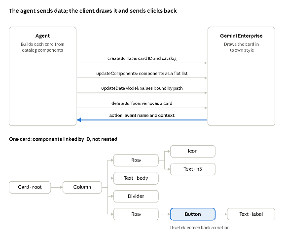

# Augustana University (Sioux Falls, SD) — 2-Hour A2UI + Google ADK Design Hackathon Guide

**Initiative:** Gemini Enterprise Campus-Wide Rollout — Academic Advising Agent (AAA)  
**Leadership:** VP for Innovation & Director of Future Operations (Terence)  
**Institution:** Augustana University, Sioux Falls, South Dakota (`augie.edu`)  
**GitHub Repository:** [`https://github.com/pjfolliard/augie-aaa-a2ui-hackathon`](https://github.com/pjfolliard/augie-aaa-a2ui-hackathon)  
**Live GitHub Pages Workbench:** [`https://pjfolliard.github.io/augie-aaa-a2ui-hackathon/`](https://pjfolliard.github.io/augie-aaa-a2ui-hackathon/)  
**Brand Identity:** [Official Augustana Brand Guidelines](https://issuu.com/augustanacollegesd/docs/augustana_university_brand_guidelines_requiremen) — Primary Blue (`#081E3F`, `PMS 282`) & Primary Yellow (`#FED102`, `PMS 109`), `ITC Garamond` & `Myriad Pro`/`Gotham`  
**Built-In Agent Skill:** [`.agents/skills/augie-a2ui-design/SKILL.md`](./.agents/skills/augie-a2ui-design/SKILL.md) (and [`.gemini/skills/augie-a2ui-design/SKILL.md`](./.gemini/skills/augie-a2ui-design/SKILL.md))  
**Data Schema Status:** Hypothetical Pre-Zion Schema (Ready for tonight/tomorrow's official **Zion Cloud Solutions** field dictionary)

---

## 1. Plain-Language Briefing: What Are ADK and A2UI?

### What is the Google Agent Development Kit (ADK)?
**Google ADK** ([`github.com/google/adk-python`](https://github.com/google/adk-python)) is Google's open-source framework for building production AI agents on **Gemini Enterprise**.
* Think of **ADK** as the **brain, identity router, and security guardrail** of the Academic Advising Agent.
* When a user signs in with their `@augie.edu` Google Workspace for Education Plus account, ADK:
  1. Identifies which of the **10 Advising Personas** they hold (`Admin`, `Provost`, `Registrar`, `Student Success`, `Deans`, `Area Chair`, `Program Director`, `Department Chair`, `Advisor`, or `Student`).
  2. Loads that persona's **Companion System Message / Prompt** from the AAA Persona Table.
  3. Enforces their **Advising Scope (Role-Based Access Control)**—ensuring a Student only ever sees `Self Only` records, an Advisor sees `Assigned Advisees Only`, a Department Chair sees `All in Department`, and the Provost/Admin see `All (University-Wide)`.

### What is A2UI (Agent-to-UI)?
**A2UI (Agent-to-UI)** ([`github.com/google/A2UI`](https://github.com/google/A2UI) / [a2ui.org](https://a2ui.org)) is Google's open-source declarative user interface protocol for AI agents.
* Traditional AI chatbots reply with **walls of Markdown prose**—which are slow to read, hard to compare across dozens of advisees, and frustrating for screen-reader or mobile users.
* With **A2UI**, the ADK agent streams lightweight **JSON messages** (`surfaceUpdate` to declare UI components + `dataModelUpdate` to supply the scoped data rows).
* The browser or Workspace client renders those JSON messages into native, accessible **Augustana University UI components**:
  * **`DataTable`**: Sortable tables with Zion field mappings, status badges, and row-level action buttons.
  * **`KPIStatRow`**: At-a-glance metric cards with trend indicators.
  * **`AlertBanner`**: High-priority hold, bottleneck, or F-1 international credit-load alerts.
  * **`DegreeProgressCard`**: Visual & screen-reader progress bars for 124-credit graduation and **SOPHIA** Core requirements.
  * **`ActionFormCard`**: Interactive forms (e.g., *Release Advising Pin*, *Approve Substitution*, *Book Advisor Appointment*) that send an `actionResponse` back to the ADK agent.

---

## 2. Minute-by-Minute 2-Hour Hackathon Runbook

This 120-minute sprint is designed so **you and Terence** (and future campus groups using Google Workspace for Education Plus or any coding agent of their choice) can focus 100% on **what each persona needs to see**—not backend database wiring.

### Phase 1: Vision, Persona Matrix & A2UI Walkthrough (`0:00 – 0:20` · 20 mins)
1. Open the live **A2UI Design Workbench** (`docs/index.html` or the GitHub Pages URL) alongside the [AAA Persona Table Google Sheet](https://docs.google.com/spreadsheets/d/1V_U0lXWP40WdDWyacq8QM_emvrwOKWCsPOZzZnWLooo/edit?gid=917434374#gid=917434374).
2. Click across the **10 Persona Pills** (`1. Admin` → `10. Student`) and notice how the **same synthetic Augustana student records** (*Amina Tesfaye*, *Lucas Sorenson*, *Priya Gurung*, *Jordan Rivera*) surface completely different columns, KPIs, and actions depending on the persona's **Advising Scope**.
3. Open the **Zion Cloud Solutions Field Mapper** button in the top bar to review the current hypothetical fields (`PENDING_ZION_*`).

### Phase 2: Priority Persona Deep-Dive & Table Design Sprint (`0:20 – 1:25` · 65 mins)
Split the 10 personas into two tracks (e.g., **Pete** takes *Executive & Unit Leadership: Provost, Deans, Area Chair, Department Chair, Student*; **Terence** takes *Systems, Operations & Direct Care: Admin, Registrar, Student Success, Program Director, Advisor*—or tackle priority personas together):

For each persona:
1. **Click Questions Q1–Q10 (`10 Personas × 10 Questions = 100 AI-Curated Views`):**
   * Rather than designing from scratch, every question (`Q1`–`Q10`) automatically loads an **AI Best-Practice Baseline** ([`docs/views/question-views.js`](./docs/views/question-views.js)) with its optimal **A2UI Layout Archetype** (`Inverted-Pyramid Triage`, `Split Action Dashboard`, or `Table-First Focus`), a question-specific Zion highlight column, sorted rows, and in-place interactive row actions.
   * You can also manually compare the 3 layouts anytime using the **`📐 A2UI Layout`** dropdown in the toolbar.
2. **Option A — No-Code Visual Table Designer:**
   * Click the **`🛠️ Visual Table & Column Designer`** tab.
   * Add, remove, or rename columns from the Hypothetical/Zion Field Catalog and click **Add Column & Update Live A2UI View**.
3. **Option B — Use Any Coding Agent with Built-In Best-Practice Skill (`gemini-cli`, Antigravity, Workspace Gemini, Claude Code, Cursor):**
   * Because the repository includes [`.agents/skills/augie-a2ui-design/SKILL.md`](./.agents/skills/augie-a2ui-design/SKILL.md), your coding agent already knows the 5–7 column density rule, layout selection matrix, official Augustana Brand Guidelines (`PMS 282` `#081E3F` / `PMS 109` `#FED102`), WCAG 2.2 AAA rules, and F-1 12-credit guardrails.
   * Or click **`🤖 Copy Prompt for Any Coding Agent`** in the top header to copy a self-contained prompt for any external LLM.

### Phase 3: 360° Accessibility & International Student Pressure Test (`1:25 – 1:45` · 20 mins)
Every persona view at Augustana University must serve **blind, deaf, visually impaired, and international students and staff**. Test each view against the 5 built-in controls in the top utility bar:
1. **Blind / Screen-Reader Check:** Switch to the **`♿ Accessibility & Screen-Reader Audit`** tab. Verify all 5 checks pass (`✅`) and click **`🔊 Speak Screen-Reader Narration Aloud`** to hear how JAWS/NVDA/VoiceOver reads the table caption, headers, and rows.
2. **Visually Impaired / Low-Vision Check:** Toggle **`◐ High-Contrast AAA`**, **`🔍 Zoom: 150%`**, and **`↔ Wide Reading Spacing`**. Verify that every status cell uses an icon (`✓`, `⚠`, `⛔`, `🌐`) + text label rather than color alone.
3. **Deaf / Hard-of-Hearing Check:** Confirm that every alert, hold, and action confirmation has 100% visual and written parity (zero audio-only cues).
4. **International Student Check:** Toggle **`🌐 Plain-Language Jargon Decoder`** and test switching the glossary language (`Español`, `中文`, `नेपाली`, `አማርኛ`). Confirm that **F-1 International 12-credit full-time guardrails** appear clearly on Student, Advisor, and Student Success views.

### Phase 4: Side-by-Side Alignment & Zion Cloud Solutions Handoff Prep (`1:45 – 2:00` · 15 mins)
1. Walk through a single student journey across 4 personas:
   * **Student (*Amina Tesfaye*):** Sees her remaining 32 credits, 1 remaining SOPHIA R2 course, F-1 14-credit status, and requests a `COSC 450` Capstone Prerequisite Override.
   * **Advisor:** Sees Amina's request in their `Assigned Advisees Only` table and endorses the override.
   * **Program Director / Department Chair:** Approves the prerequisite override and checks `COSC 210` / `COSC 450` seat capacity.
   * **Registrar:** Posts the approved override to the degree audit.
2. Click **`📥 Download .json`** (or commit changes to GitHub) so your finalized table designs are ready to bind to the **Zion Cloud Solutions** field list when it arrives tonight/tomorrow.

---

## 3. Zion Cloud Solutions Technical Specification: A2UI v0.9 in Gemini Enterprise ("What You Can and Can't Do")

**Zion Cloud Solutions** provided the official **Gemini Enterprise A2UI v0.9** architecture guide (`adk_agent/a2ui_catalog.json` and `adk_agent/agent_card.json` are already pre-configured with these rules):

### Four Messages Out, One Back (`"version": "v0.9"`)
* **Outbound from Agent:** `createSurface` → `updateComponents` (`surfaceUpdate`) → `updateDataModel` (`dataModelUpdate`) → `deleteSurface`
* **Inbound from User:** `action` (button clicks and form inputs resolved from the data model)
* **Composite Catalog ID:** `https://www.gstatic.com/vertexaisearch/a2ui/v0_9/gemini_enterprise_composite_catalog.json`

### 69 Built-In Catalog Components Available to Our Designs
| Family | Components | How We Use Them in Augustana AAA |
| :--- | :--- | :--- |
| **Basic** | `Text`, `Image`, `Icon`, `Video`, `AudioPlayer`, `Row`, `Column`, `List`, `Card`, `Tabs`, `Modal`, `Divider`, `Button`, `TextField`, `CheckBox`, `ChoicePicker`, `Slider`, `DateTimeInput` | Structural layout containers (`Column`, `Row`) & accessible inputs |
| **Material layout** | `MaterialCard`, `MaterialRow`, `MaterialColumn`, `MaterialDialog`, `MaterialDivider`, `MaterialExpansionPanel`, `MaterialGridList` | `KPIStatRow` (`MaterialGridList` + `MaterialCard`) & `Split Action Dashboard` (`MaterialRow`) |
| **Material display** | `MaterialText`, `MaterialIcon`, `MaterialImage`, `MaterialBadge`, `MaterialProgressBar`, `MaterialProgressSpinner`, `MaterialTable` | **`DataTable` (`MaterialTable`)**, **`DegreeProgressCard` (`MaterialProgressBar`)**, status badges (`MaterialBadge`) |
| **Material actions** | `MaterialButton`, `MaterialIconButton`, `MaterialMenu`, `MaterialTabs`, `MaterialTab` | In-table `rowActions` (`MaterialButton`) & form submissions |
| **Material input** | `MaterialInput`, `MaterialCheckbox`, `MaterialSelect`, `MaterialRadioButton`, `MaterialChips`, `MaterialButtonToggle`, `MaterialSlideToggle`, `MaterialSlider`, `MaterialDatepicker`, `MaterialTimepicker` | **`ActionFormCard`** (`MaterialSelect`, `MaterialInput`, `MaterialDatepicker`) |
| **Gemini Enterprise extras** | `Canvas` (side panel), `IFrameSrcdoc` (sandboxed HTML), `IFrameUrl` (allowlisted sites only) | Side-panel degree audit & schedule simulator (`Canvas`) |

### What You Can't Do in Gemini Enterprise A2UI v0.9 (And What to Do Instead)
| You Can't... | Do This Instead |
| :--- | :--- |
| **Use A2UI `v0.9.1`** | Stick to `"version": "v0.9"` on every message. |
| **Host on Vertex AI Agent Engine** | Host as an **A2A v0.3 agent on Google Cloud Run** (`adk_agent/agent_card.json`). |
| **Authenticate with API keys or custom headers** | Grant `roles/run.invoker` to the Discovery Engine service agent on `.run.app`, or use OAuth behind a custom domain / Load Balancer / Apigee. |
| **Rely on Gemini Enterprise Model Armor automatically** | Call **Model Armor** from the agent and re-validate all `action` form values server-side (`validate_action_with_model_armor` in `adk_agent/agent.py`). |
| **Send files via ADK `save_artifact`** | Send downloadable files (PDF degree audits, SAP CSV exports) as **A2A file parts**. |
| **Put links or images inside `Text`** | Use `Image`/`MaterialImage` for images and `MaterialButton`/`MaterialCard` with an `openUrl` action for links. |

---

## 4. Zion Cloud Solutions — Jenzabar J1 (`J1PRD`) Connector API Reference v1.0 (26 Endpoints)

Full PDF saved in repository: [`data/Zion_AAA_Connector_API_Reference.pdf`](./data/Zion_AAA_Connector_API_Reference.pdf) (*Version 1.0, 24 September 2026*).

* **Base URL:** `https://connector-api-385429559879.us-central1.run.app` (Google Cloud Run `us-central1`, project `fit-stream-495320-f6`)
* **Data Source:** **Jenzabar J1 (`J1PRD`)**, read live over the site-to-site VPN (zero data cached; read-only `GET` endpoints only—no endpoint writes to J1).
* **Authentication (2 Layers Required):**
  1. `Authorization: Bearer <Google OIDC identity token>` (`roles/run.invoker`)
  2. `X-User-Id: <J1 ID_NUM>` and `X-User-Role: student | advisor | advising_admin` (resolved from SSO email via `GET /identity/resolve?email=...`)
* **26 Endpoints Across 5 Groups:**
  * **Catalog (6):** `/health`, `/terms`, `/terms/resolve`, `/catalog/courses`, `/catalog/sections`, `/catalog/section`
  * **Identity (2):** `/identity/resolve`, `/me/profile`
  * **Student (8):** `/students/me/registration`, `/students/me/holds`, `/students/me/registration-window`, `/students/me/gpa`, `/students/me/schedule-conflicts`, `/students/me/course-eligibility`, `/students/me/recommend-next-term`, `/students/me/degree-progress` (`?detail=true&checklist=true&rules=true`)
  * **Advisor (9):** `/advisors/me/caseload` (`?status=unregistered`), plus `/advisors/me/advisees/{adviseeId}/...` mirroring all 8 student routes (with automatic J1 ownership check returning `404` if not owned)
  * **Administrator (2):** `/students/search?q=...` and `/advisors/me/caseload?yr=...&trm=...&scope=all` (`total: 3424`)
* **All 100 Persona Views Now Mapped:** Every table column across [`docs/views/default-views.js`](./docs/views/default-views.js), [`docs/views/question-views.js`](./docs/views/question-views.js), and [`data/zion_schema_mapping.json`](./data/zion_schema_mapping.json) is now mapped to its official J1 Connector API v1.0 JSON path (or flagged `[Phase 2 J1 Query]` where aggregate/biographical fields are outside v1.0's 26 endpoints).
