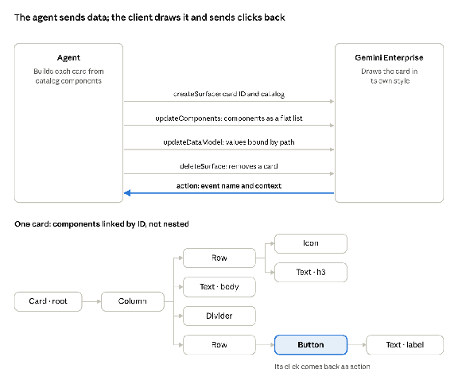

# Augustana University (Sioux Falls, SD) — Academic Advising Agent (AAA)
### 2-Hour A2UI + Google ADK Interface Design Hackathon & Starter Kit

[](https://www.augie.edu)
[](https://github.com/pjfolliard/augie-aaa-a2ui-hackathon)
[](./HACKATHON_GUIDE.md)
[-8D9EBC?style=for-the-badge)](./data/zion_schema_mapping.json)

Welcome to the **Augustana University (Sioux Falls, South Dakota)** **Academic Advising Agent (AAA)** interface design repository, part of our campus-wide **Gemini Enterprise** rollout.

* **GitHub Repository:** [`https://github.com/pjfolliard/augie-aaa-a2ui-hackathon`](https://github.com/pjfolliard/augie-aaa-a2ui-hackathon) (`git clone https://github.com/pjfolliard/augie-aaa-a2ui-hackathon.git`)
* **Live GitHub Pages Workbench:** [`https://pjfolliard.github.io/augie-aaa-a2ui-hackathon/`](https://pjfolliard.github.io/augie-aaa-a2ui-hackathon/)
* **Official Brand Guidelines:** [Augustana University Brand Guidelines & Requirements (Issuu)](https://issuu.com/augustanacollegesd/docs/augustana_university_brand_guidelines_requiremen) (`PMS 282` Navy `#081E3F` & `PMS 109` Yellow `#FED102`)
* **Built-In AI Design Skill:** [`.agents/skills/augie-a2ui-design/SKILL.md`](./.agents/skills/augie-a2ui-design/SKILL.md) (also mirrored at [`.gemini/skills/augie-a2ui-design/SKILL.md`](./.gemini/skills/augie-a2ui-design/SKILL.md))

This repository provides a complete **2-Hour Design-Build Hackathon Workbench & Starter Project** built on the **Google Agent Development Kit (ADK)** and **A2UI (Agent-to-UI)**. Anyone using **Google Workspace for Education Plus** or **any coding agent of their choice** can inspect, customize, and pressure-test accessible AI-curated tables and views across all **10 Augustana Advising Personas × 10 Canonical Questions = 100 Bespoke Views**.

---

## 🚀 Quick Start & Updated Design Directions

1. **Clone or Open the Repository:**
   ```bash
   git clone https://github.com/pjfolliard/augie-aaa-a2ui-hackathon.git
   cd augie-aaa-a2ui-hackathon
   ```
2. **Launch the Zero-Install Interactive A2UI Workbench:**
   * **Live on GitHub Pages:** [`https://pjfolliard.github.io/augie-aaa-a2ui-hackathon/`](https://pjfolliard.github.io/augie-aaa-a2ui-hackathon/)
   * **Locally:** Open [`docs/index.html`](./docs/index.html) directly in your browser (or run `python3 -m http.server 8080 --directory docs` and visit `http://localhost:8080`).
3. **Follow the "AI-First Baseline → Human Refinement" Design Workflow:**
   * **Step 1 — Pick a Persona (`1. Admin` → `10. Student`) & Any Question (`Q1`–`Q10`):** The workbench ([`docs/views/question-views.js`](./docs/views/question-views.js)) automatically renders the **AI Best-Practice View** for that exact question and selects the optimal **A2UI Layout Archetype**:
     * `Inverted-Pyramid Triage` (`AlertBanner` → `KPIStatRow` → `DataTable` → `ActionFormCard`)
     * `Split Action Dashboard` (`DataTable` on the left + side-by-side `DegreeProgressCard` & `ActionFormCard` on the right)
     * `Table-First High-Density Focus` (`DataTable` pinned at the top for bulk roster/bottleneck audits)
   * **Step 2 — Refine Columns No-Code or via Agent Skill:**
     * **No-Code:** Open the **`🛠️ Visual Table & Column Designer`** tab to add/remove columns from the pre-loaded Zion Cloud Solutions field dropdown, or test row action buttons live in-place.
     * **Coding Agent (With Built-In Skill):** Ask **Antigravity**, **Google Gemini CLI (`gemini`)**, **Claude Code**, or **Cursor** in plain English. Because the repo includes [`.agents/skills/augie-a2ui-design/SKILL.md`](./.agents/skills/augie-a2ui-design/SKILL.md), the agent automatically enforces the 5–7 column cap, `PMS 282` Navy / `PMS 109` Yellow brand rules, WCAG 2.2 AAA screen-reader headers, and F-1 12-credit guardrails.
   * **Step 3 — Validate & Push to GitHub:**
     ```bash
     python3 scripts/validate_project.py
     git add -A && git commit -m "Refine A2UI persona views" && git push origin main
     ```
4. **Open the Source Persona Matrix & Runbook:**
   * [AAA Persona Table (Google Sheet)](https://docs.google.com/spreadsheets/d/1V_U0lXWP40WdDWyacq8QM_emvrwOKWCsPOZzZnWLooo/edit?gid=917434374#gid=917434374) · Local exports: [`data/personas.json`](./data/personas.json) & [`data/personas.csv`](./data/personas.csv)
   * See [`HACKATHON_GUIDE.md`](./HACKATHON_GUIDE.md) for the updated minute-by-minute agenda.

---

## 🧠 What Are Google ADK and A2UI?

### 1. Google Agent Development Kit (ADK) — *The Brain & RBAC Guardrails*
[**Google ADK**](https://github.com/google/adk-python) (`google-adk`) is Google's open-source framework for building, orchestrating, and deploying agents on **Gemini Enterprise**. In the Augustana Academic Advising Agent, ADK:
* Authenticates the user's `@augie.edu` role and loads the matching **Companion System Prompt** from [`data/personas.json`](./data/personas.json).
* Enforces strict **Advising Scope (Role-Based Access Control)** boundaries—from `All (University-Wide)` for **Admin / Provost**, down to `All in Department` for **Department Chair**, `Assigned Advisees Only` for **Advisor**, and `Self Only` for **Student**.
* Uses `A2uiSchemaManager` to instruct the Gemini model to output structured **A2UI JSON** rather than unstructured walls of text.

### 2. A2UI v0.9 in Gemini Enterprise — *Declarative Generative UI (Zion Cloud Solutions Spec)*
[**A2UI**](https://github.com/google/A2UI) ([a2ui.org](https://a2ui.org)) is Google's open-source declarative UI protocol (`application/a2ui+json`). Per **Zion Cloud Solutions'** Gemini Enterprise A2UI v0.9 specification:
* **Strictly `"version": "v0.9"`** on every message (`v0.9.1` is not supported in Gemini Enterprise).
* **Official Composite Catalog ID:** `https://www.gstatic.com/vertexaisearch/a2ui/v0_9/gemini_enterprise_composite_catalog.json` (69 built-in components across Basic, Material layout/display/actions/input, and Gemini Enterprise extras `Canvas`, `IFrameSrcdoc`, `IFrameUrl` — mapped in [`adk_agent/a2ui_catalog.json`](./adk_agent/a2ui_catalog.json)).
* **Four Messages Out, One Back:** The agent sends `createSurface`, `updateComponents` (`surfaceUpdate`), `updateDataModel` (`dataModelUpdate`), and `deleteSurface`, and receives `action` back when a user clicks a button or submits a form.
* **Cloud Run A2A v0.3 Hosting & Model Armor:** Hosted on **Google Cloud Run** as an **A2A v0.3** agent ([`adk_agent/agent_card.json`](./adk_agent/agent_card.json)) with server-side **Model Armor** validation and **A2A file parts** for PDF/CSV exports.



---

## 🛠️ Trusted Open-Source Google Toolchain on GitHub

This project integrates **six official open-source Google tools on GitHub** so participants can work with trusted open-source utilities:

| Open-Source Google Tool | Official GitHub Repo | How to Use It in This Repository |
| :--- | :--- | :--- |
| **1. Google Gemini CLI** (`gemini`) | [`google-gemini/gemini-cli`](https://github.com/google-gemini/gemini-cli) | Run `npx https://github.com/google-gemini/gemini-cli` in the repo root. It automatically reads [`GEMINI.md`](./GEMINI.md) to build/edit persona A2UI views. |
| **2. Google Workspace CLI** (`gws`) | [`googleworkspace/cli`](https://github.com/googleworkspace/cli) | Run [`./scripts/gws_sync_personas.sh`](./scripts/gws_sync_personas.sh) to sync the AAA Persona Google Sheet & inspect `@augie.edu` Google Groups via JSON. |
| **3. Google ADK** (`adk`) | [`google/adk-python`](https://github.com/google/adk-python) | Run `adk web adk_agent` to launch the Python ADK reference agent ([`adk_agent/agent.py`](./adk_agent/agent.py)). |
| **4. Google Agents CLI** (`agents-cli`) | [`GoogleCloudPlatform/agent-starter-pack`](https://github.com/GoogleCloudPlatform/agent-starter-pack) | Uses [`.agents-cli-spec.md`](./.agents-cli-spec.md) (`uv tool install google-agents-cli`) for evaluation and Gemini Enterprise publishing. |
| **5. Google A2UI** (`a2ui-agent-sdk`) | [`google/A2UI`](https://github.com/google/A2UI) | Powers the component catalog ([`adk_agent/a2ui_catalog.json`](./adk_agent/a2ui_catalog.json)) and client renderer ([`docs/a2ui-renderer.js`](./docs/a2ui-renderer.js)). |
| **6. Google Apps Script CLI** (`clasp`) | [`google/clasp`](https://github.com/google/clasp) | Deploys [`workspace_templates/AppsScript_Sheets_A2UI_Sidebar.gs`](./workspace_templates/AppsScript_Sheets_A2UI_Sidebar.gs) into Google Sheets for Workspace Education Plus users. |

*(Also includes [`AGENTS.md`](./AGENTS.md) and [`CLAUDE.md`](./CLAUDE.md) so Antigravity, Claude Code, Cursor, and GitHub Copilot work out of the box.)*

---

## 👥 The 10 Augustana Academic Advising Personas

| # | Persona Role | Advising Scope (RBAC) | Primary Interface & Table Focus |
| :- | :--- | :--- | :--- |
| **1** | **Admin** | `All (University-Wide)` | System-wide retention, unassigned advisee audits, portal usage, global advisor ratios, systemic holds, and Financial Aid SAP exports. |
| **2** | **Provost** | `All (University-Wide)` | Graduation rates by academic unit, 3-year enrollment trends, advising load distribution, SOPHIA fulfillment, STEM vs. non-STEM persistence, and critical seat shortages. |
| **3** | **Registrar** | `All (Systems & Compliance)` | Pending degree clearances, core curriculum substitutions, policy overrides, transfer equivalencies, credit overloads (>18 cr), prerequisite conflicts, and residency credit compliance. |
| **4** | **Student Success** | `All (Systems & Compliance)` | Early warning flags, academic warning/probation cohorts, unregistered outreach, active holds, gateway DFW rates, transfer retention, and F-1 / ADA holistic care. |
| **5** | **Deans** | `All in School/College` | School credit hour production (SCH), major retention rates, graduation eligibility, average time-to-degree, bottlenecks, and degree plan exceptions. |
| **6** | **Area Chair** | `All in Area (Arts & Sciences)` | Divisional enrollment distribution, withdrawal rates, cross-departmental course bottlenecks, foundational completion, and area advising loads. |
| **7** | **Program Director** | `All in Program` | Program plan-of-study enrollment, under-enrolled core courses, capstone readiness, authoritative course substitution approvals, and elective track trends. |
| **8** | **Department Chair** | `All in Department` | Faculty advising capacity & assignment load, adding course sections, departmental probation, prerequisite overrides, and new major declarations. |
| **9** | **Advisor** | `Assigned Advisees Only` | Assigned advisee registration status, prerequisite overrides, remaining credits to 124, SOPHIA checklist, holds, SAP status, midterm grades < C, and major-change simulations. |
| **10** | **Student** | `Self Only` | Next-semester course recommendations, expected graduation date, major-change what-if explorer, remaining degree & SOPHIA credits, F-1 12-credit drop guardrails, and booking advisor appointments. |

---

## ♿ Universal Accessibility & International Student Commitment (WCAG 2.2 AA/AAA)

Every component in this starter kit is built for **blind, deaf, visually impaired, and international students and staff**:
* **Official Augustana University (Sioux Falls, SD) Palette Tested to WCAG AAA:** Primary Navy `#081E3F` on White `#FFFFFF` (**16.6:1** contrast) and Primary Navy `#081E3F` on Gold `#FED102` (**11.3:1** contrast)—both far above the 7.0:1 WCAG 2.2 AAA requirement.
* **Blind & Screen-Reader Users:** Semantic HTML5 landmarks, keyboard skip links, `<table aria-describedby>` with mandatory `<caption>`, `<th scope="col">`, `<th scope="row">`, `aria-sort`, polite `aria-live` updates, and a built-in **Screen-Reader Narration Transcript & Audio Preview**.
* **Visually Impaired & Color-Blind Users:** 1-click **High-Contrast AAA Mode**, **125% / 150% Text & Target Zoom**, **Wide Reading Spacing**, **48×48px minimum tap targets**, and non-color redundant status badges (`✓`, `⚠`, `⛔`, `🌐` + text).
* **Deaf & Hard-of-Hearing Users:** 100% visual and text parity—zero audio-only alerts or voice-only interactions.
* **International Students:** Built-in **Plain-Language US Higher-Ed Jargon Decoder** (`SOPHIA`, `DFW Rate`, `SAP`, `Hold`, `F-1 Full-Time Load`, `Prerequisite Override`, `Residency Requirement`) with multilingual glossary previews (`English`, `Español`, `中文`, `नेपाली`, `አማርኛ`) and explicit **SEVIS F-1 12-credit full-time enrollment guardrails**.

---

## 🗂️ Hypothetical Schema Notice & Zion Cloud Solutions Adapter

All fields currently displayed in the workbench are **hypothetical** (`PENDING_ZION_*`). When **Zion Cloud Solutions** delivers the official field dictionary tonight or tomorrow:
1. Update [`data/zion_schema_mapping.json`](./data/zion_schema_mapping.json) (or use the **Zion Cloud Solutions Field Mapper** modal inside the web workbench).
2. Run `python3 scripts/build_data.py && python3 scripts/validate_project.py` to propagate and verify all field mappings across the 10 personas.
